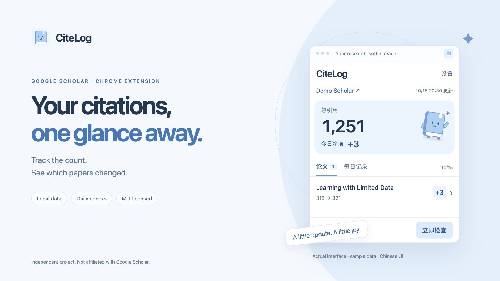
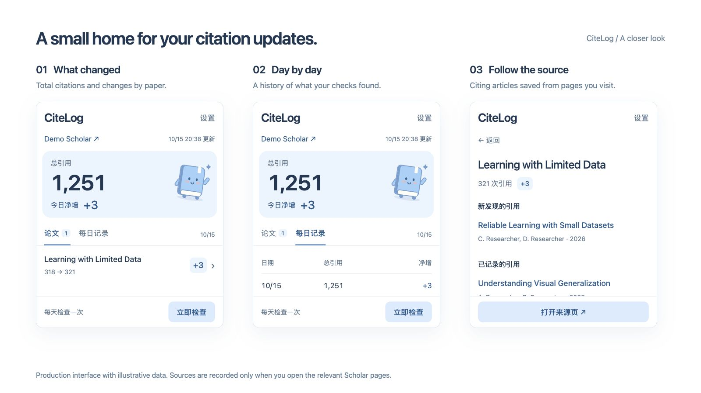

  <a href="README.md">English</a> · <strong>简体中文</strong>

  <a href="https://github.com/LilanOvO/citelog/releases/download/v0.1.4/citelog-chrome.zip"><strong>下载 Chrome 插件</strong></a> ·
  <a href="docs/INSTALL.zh-CN.md">安装指南</a> ·
  <a href="https://github.com/LilanOvO/citelog/issues">反馈问题</a>

  

CiteLog 把 Google Scholar 引用变化放进一个小弹窗：总引用数、每天观察到的变化，以及哪些论文增加了引用，点开就能看。

**早期试用版 · Chrome 116+ · 中文界面**  
目前通过本地加载安装，尚未上架 Chrome 应用商店。

## 少一点反复查看

- **变化一眼看清。** 总引用、每日观察到的净增、逐篇论文变化。
- **每天留一份记录。** 默认每天检查一次，也可以设置为 1–720 小时。
- **增加时提醒。** 桌面通知可以在设置中关闭。
- **看是谁引用了你。** 正常浏览 Scholar 来源页时保存引用文章，完整浏览后与上一次比较。

  

截图使用真实插件界面与演示数据，姓名、论文和引用数仅作展示。

## 安装

1. [下载 **citelog-chrome.zip**](https://github.com/LilanOvO/citelog/releases/download/v0.1.4/citelog-chrome.zip)，解压，放在一个之后不会移动或删除的位置。
2. 在 Chrome 地址栏输入 `chrome://extensions`，打开「开发者模式」，点击「加载已解压的扩展程序」，选择解压后包含 `manifest.json` 的文件夹。
3. 固定 **CiteLog** 图标，打开弹窗，粘贴公开的 Google Scholar 个人主页链接，点击「绑定主页」。

不用安装 Node.js，不用编译，也不用注册 CiteLog 账号。第一次成功检查会建立记录起点。

[查看图解安装与常见问题 →](docs/INSTALL.zh-CN.md)

**已安装本地试用版？** 请覆盖原安装目录中的文件，再点击「重新加载」。保持目录不变，才能保留原有扩展身份与记录。[查看更新方法 →](docs/INSTALL.zh-CN.md#更新并保留记录)

## 引用来源怎么记录

CiteLog 自动检查**个人主页上的引用数**；引用来源文章在你主动打开来源页时记录。

1. 从某篇论文的「被引用次数 / Cited by」进入，不加筛选，从第一页依次浏览到最后一页。第一次完整浏览建立基线。
2. 之后再次完整浏览，CiteLog 会比较两次列表，显示新发现的文章。

只浏览部分页面时，会保存看到的文章，但不判断哪些是新增。一次完整浏览需在 30 分钟内完成，且来源数不超过当前每篇 500 条的上限。[查看原理与当前限制 →](docs/HOW-IT-WORKS.md)

「今日」表示 **CiteLog 今天观察到的变化**。Scholar 的引用数和来源列表可能不同步，因此无法保证把某篇新发现的文章对应到某一次引用数增长。

## 记录留在本机

设置和记录保存在当前 Chrome 浏览器配置中。没有服务器、统计分析、广告或云同步。遇到 Scholar 验证码或访问限制时，自动检查会暂停；安装插件不会绕过这些限制。

[隐私与权限说明](PRIVACY.md#简体中文) · [验证范围与当前限制](TESTING.md)

## 一起改进

欢迎反馈问题、改进翻译或提交小而清楚的功能修正。反馈时请附上 Chrome 版本、操作过程和实际表现，截图记得隐去个人信息。

[贡献指南](CONTRIBUTING.md) · [版本记录](CHANGELOG.md) · [MIT 许可证](LICENSE)

CiteLog 是独立项目，与 Google 及 Google Scholar 无隶属关系。
