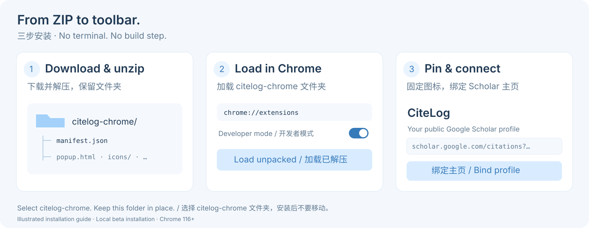

# Install CiteLog

[简体中文](INSTALL.zh-CN.md) · [Back to the project](../README.md)

You need **desktop Chrome 116 or later**, access to `scholar.google.com`, and a public Scholar profile. The current interface is Chinese. No development tools are needed.

## 1. Download and unzip

[**Download citelog-chrome.zip — v0.1.4 preview**](https://github.com/LilanOvO/citelog/releases/download/v0.1.4/citelog-chrome.zip)

Unzip it into a permanent folder, for example `Documents/citelog-chrome`. Keep this folder after installation: Chrome loads the extension directly from it.

Choose **citelog-chrome.zip**, rather than GitHub's automatically generated “Source code” downloads. The Chrome package is ready to load.

## 2. Load it in Chrome

1. Type `chrome://extensions` into Chrome's address bar.
2. Turn on **Developer mode** in the upper-right corner.
3. Click **Load unpacked**.
4. Select the extracted **citelog-chrome** folder. You should find `manifest.json` directly inside it.



If your unzip tool adds an extra outer folder, open it and select the inner folder containing `manifest.json`. Do not select the ZIP file itself.

## 3. Bind your profile

Click Chrome's puzzle-piece icon and pin **CiteLog**. Open CiteLog, paste your public profile URL, and click **绑定主页** (Bind profile).

A valid link looks like this:

```text
https://scholar.google.com/citations?user=YOUR_PROFILE_ID
```

The first successful check records your total and establishes a baseline. Subsequent checks can show changes; CiteLog cannot reconstruct history from before installation.

Checks run every 24 hours by default. Open **设置** (Settings) to choose 1–720 hours or turn off desktop reminders. Chrome must be running; sleep and browser scheduling can delay checks.

| In the popup | Meaning |
|---|---|
| 总引用 | Total citations |
| 今日净增 | Net change observed today |
| 区间净增 | Change over an interval with missed days |
| 论文 / 每日记录 | Papers / Daily history |
| 设置 / 立即检查 | Settings / Check now |

For citing articles, follow the [two-visit source workflow](HOW-IT-WORKS.md#citing-articles-two-complete-visits).

## Update without losing your records

1. Locate the folder you originally loaded into Chrome.
2. Unzip the new Chrome package elsewhere, then copy its **contents** into that original folder, replacing the old extension files. `manifest.json` must remain in the same location.
3. Open `chrome://extensions` and click **Reload** on CiteLog.
4. Refresh any Scholar tabs that were open during the update.

**Keep the original folder path. Do not remove and reinstall the extension.** Local records belong to its Chrome installation; changing the installation path can create a different extension identity. Uninstalling deletes its storage. There is no cloud backup or history import yet.

If you used an earlier local trial package, your existing path may end with `scholar-local-trial-v0.1.0/extension/`. That is fine: copy the new runtime files into **that `extension/` folder**, even though the new download has a different name. The CitePulse-to-CiteLog rename preserves the existing storage format.

## Common installation issues

| What you see | What to do |
|---|---|
| “Manifest file is missing or unreadable” | Select the folder that directly contains `manifest.json`. Unzip first. |
| No CiteLog icon in the toolbar | Open Chrome's puzzle-piece menu and click the pin next to CiteLog. |
| No citation changes after binding | The first check is a baseline. Changes appear after later successful observations. |
| Check interval is too short | Wait at least 15 minutes after the previous check attempt. Manual checks use the same cooldown. |
| Scholar times out or asks for verification | Open your Scholar profile normally and follow any page prompt. Keep the extension's existing records and try again later. Installing CiteLog does not fix network access or remove Scholar limits. |
| Sources are empty or marked incomplete | Open the relevant paper's Cited by list yourself. A first complete, unfiltered visit establishes a baseline; a later complete visit identifies new articles. |
| Managed browser does not allow Developer mode | Ask your device administrator about their extension policy. There is no Web Store installation option yet. |

If an issue persists, [open an issue](https://github.com/LilanOvO/citelog/issues). Include your Chrome and CiteLog versions, the steps taken, and the visible message. Remove personal details from screenshots; do not attach cookies, tokens, or your full browser profile.

## Install from source

Download or clone the repository, then load its **`extension/`** directory using the steps above. No build is required to run the checked-in extension. Node.js is needed only for [development checks](../CONTRIBUTING.md).
